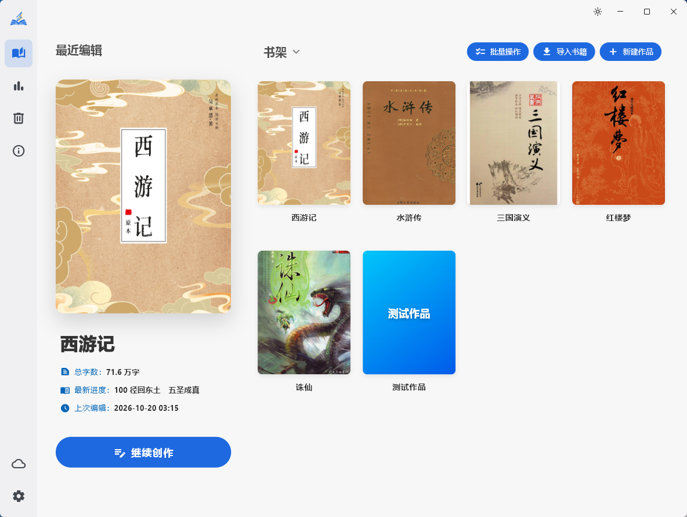
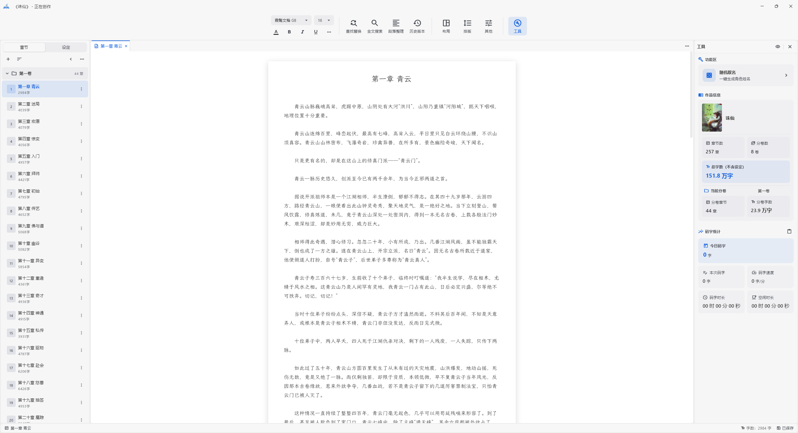
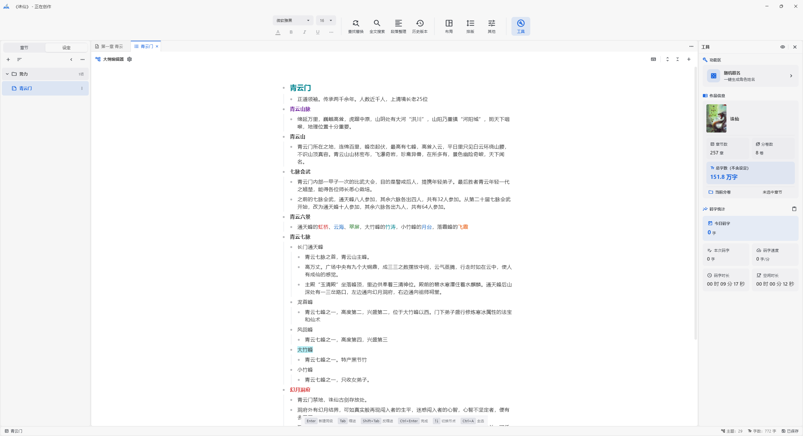
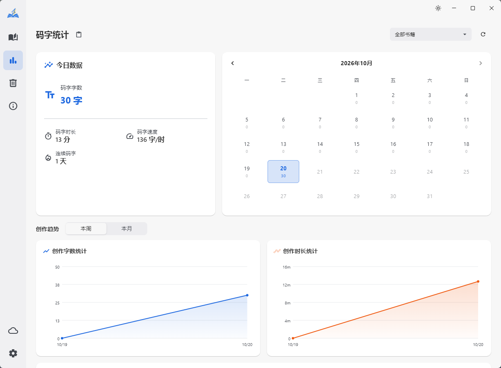

<div align="center">


# 快码字 QuickWrite

**专注于小说创作的本地写作工具**

把作品、章节、大纲设定与码字工具集中在一处，帮你专注地把故事写下去。

[](#-下载与安装)
[](LICENSE)
[](https://github.com/yic77455/QuickWrite/releases)
[](https://github.com/yic77455/QuickWrite/commits)
[](https://github.com/yic77455/QuickWrite/stargazers)

</div>

<!-- ========================================================= -->
<!-- 截图占位 [S0]：主界面总览（建议放置工作台全貌，宽屏）        -->
<!-- ========================================================= -->
<div align="center">
  
</div>

---

## 目录

- [项目简介](#项目简介)
- [功能特性](#功能特性)
- [界面预览](#界面预览)
- [下载与安装](#下载与安装)
- [从源码构建](#从源码构建)
- [快捷键](#快捷键)
- [技术栈](#技术栈)
- [项目结构](#项目结构)
- [反馈与贡献](#反馈与贡献)
- [开源许可](#开源许可)

## 项目简介

快码字（QuickWrite）是一款面向小说创作者的本地写作工具。它把**作品管理、章节编辑、大纲设定、码字统计**等创作环节整合到一个界面中，让灵感与文稿都留在原地，减少在多个工具之间来回切换的成本。

- **本地优先**：所有创作数据默认保存在本机，无需联网即可完整使用。
- **云备份可选**：支持自选 WebDAV 平台做云端备份，不绑定账号、不采集内容。
- **跨平台**：桌面端（Windows）与移动端（Android）双端适配，同一套数据与操作习惯。
- **完全免费**：没有会员制，没有任何功能限制，无需购买、无需注册、无需支付任何费用。
- **开源项目**：基于 GPL-3.0 协议开源，代码安全透明，不收集任何用户数据，无广告、无跟踪、无隐私问题。

## 功能特性

### 作品管理：书架

- 作品以封面网格展示，支持**分组归类**、封面自定义与最近编辑入口，方便在多个项目间快速切换。
- 支持**批量操作**：批量选择、全选、批量删除或移动分组，长列表也能高效整理。
- 内置**回收站**，误删的作品与条目可随时恢复。
- 支持从 **docx / txt** 等文本文件**导入**作品，快速把已有作品搬进来。

### 编辑器：为长文而生

- 正文编辑基于自研排版的超长文本编辑器，**十万字级章节依旧流畅**，滚动、输入、选中不卡顿。
- 完整**文字格式**：字体、字号、字体颜色、字底颜色、加粗、斜体、下划线；章节标题拥有独立的字号与颜色样式。
- **查找替换**与**全文搜索**，支持跨章节定位与跳转。
- **段落整理**：一键规范化段落缩进与排版。
- **历史版本**：为文稿保留可回溯的编辑快照，写坏了也能找回。
- **自定义高亮**：按需标记关键词，为人物、伏笔、待改之处建立视觉索引。
- 工作台采用**多标签页**设计，正文、设定与备份预览可在标签间并排切换。

### 大纲与设定

- **大纲编辑器**：像 Workflowy 或 幕布 那样处理你的大纲，快速组织你的创作。
- **节点树**：支持无限层级、折叠展开、缩进与层级提升，节点间以连接线勾勒结构。
- 节点**批量编辑**：选中多个节点后统一调整文字样式、颜色、层级与缩进；长按/滑动可连续框选。
- **设定目录**：角色、地点、势力等设定条目的结构化归档，与大纲并肩管理，随用随查。

### 码字统计

- **今日统计**：当天新增字数、码字时长、平均速度一目了然。
- **长期趋势**：折线图与**写作日历**记录每日产出，坚持与否有据可查。
- 章节字数、全书字数实时统计，码字目标进度随手可见。

### 云同步与数据安全

- 基于 **WebDAV** 的云备份，可自选任意支持 WebDAV 的网盘或私有服务器。
- 提供**同步计划**与**风险提示**：覆盖同步前先做差异比对，高风险覆盖会要求二次确认。
- **备份与恢复**：支持数据目录、缓存目录、备份目录的独立配置，并可导出/导入完整备份。
- 内置**数据完整性检查**，及时发现异常并给出修复建议。

### 个性化与外观

- **浅色 / 深色主题**一键切换，并内置多套配色方案。
- **自定义主题**：可视化主题编辑器，自由搭配主色、背景与强调色。
- **字体管理**：支持导入本地字体，推荐字体可一键下载；界面字体与正文字体可分别设置，互不干扰。
- 编辑区**布局**自由调整、**纸张/排版模式**切换与版式微调。

### 桌面端增强

- **多窗口并行**：每个作品可独立开窗，参照资料、互相对照写作互不干扰。
- **预览模式**：像 IDE 那样打开预览标签页，快速查看其他章节与设定。
- **系统托盘**与**关闭行为**自定义，支持最小化到托盘。

### 移动端适配

- Android 端针对触屏重新设计交互：**底部导航栏**、**抽屉式目录与侧栏**、**顶部悬浮式操作栏**。
- 提供**快捷输入栏**与**成对中文标点自动补全**，移动端也能高效码字。
- 大纲编辑器配备**键盘上方专用工具栏**，格式、颜色、缩进操作触手可及。
- 支持外接物理键盘，**快捷键与桌面端保持一致**。

## 界面预览

> 以下截图位置已预留，图片文件名与说明一一对应，截图后按文件名放入 `docs/images/` 即可自动显示。

### 书架首页

<div align="center">
  
</div>

### 工作台

<div align="center">
  
</div>

### 大纲与设定

<div align="center">
  
</div>

### 码字统计

<div align="center">
  
</div>

## 下载与安装

应用发布在 [GitHub Releases](https://github.com/yic77455/QuickWrite/releases)，国内用户也可访问 [Gitee Releases](https://gitee.com/yic77455/quick-write/releases) 获得更稳定的下载速度。

### Windows

1. 在 Releases 页面下载最新版 Windows 安装包（或压缩包）。
2. 运行安装程序，或解压后直接运行 `QuickWrite.exe`。
3. 首次启动后可在「主界面 → 云同步」中配置 WebDAV 服务器地址进行数据同步。

### Android

1. 在 Releases 页面下载最新版 `.apk` 安装包。
2. 在手机允许「安装未知来源应用」后完成安装。
3. 应用内置更新检查，后续版本可在应用内直接下载升级。

> 如需自行编译，请参考下方的[从源码构建](#从源码构建)。

## 从源码构建

### 环境要求

- [Flutter SDK](https://docs.flutter.dev/get-started/install)（Dart SDK `^3.11.0`）
- 构建 Windows 端：Visual Studio 2022（含「使用 C++ 的桌面开发」工作负载）
- 构建 Android 端：Android Studio 与 Android SDK

### 通用步骤

```bash
# 1. 获取依赖
flutter pub get

# 2. 生成数据库代码（isar schema 变更后需要执行）
dart run build_runner build --delete-conflicting-outputs
```

### 构建 Windows

```bash
flutter build windows --release
```

产物位于 `build/windows/x64/runner/Release/`，整个目录即为可分发内容。

### 构建 Android

```bash
# 推荐仅打包 arm64 单架构，减小体积
flutter build apk --release --target-platform android-arm64
```

产物位于 `build/app/outputs/flutter-apk/`。正式发布请在 `android/key.properties` 中配置签名信息（该文件与密钥不入版本库）。

## 快捷键

### 正文编辑器

| 功能 | 按键 |
| --- | --- |
| 全选 | `Ctrl+A` |
| 剪切选中 / 当前行 | `Ctrl+X` |
| 复制选中 / 当前行 | `Ctrl+C` |
| 粘贴 | `Ctrl+V` |
| 撤销 | `Ctrl+Z` |
| 重做 | `Ctrl+Y` / `Ctrl+Shift+Z` |
| 缩进 | `Tab` |
| 查找 | `Ctrl+F` |
| 替换 | `Ctrl+H` / `Ctrl+Alt+F` |
| 保存 | `Ctrl+S` |
| 选中当前行 | `Ctrl+L` |
| 删除当前行 | `Ctrl+D` |
| 移动当前行 | `Alt+↑` / `Alt+↓` |
| 移动光标（单词边界） | `Alt+←` / `Alt+→` |
| 移动到页首 / 页尾 | `Ctrl+↑` / `Ctrl+↓` |

### 大纲编辑器

| 功能 | 按键 |
| --- | --- |
| 切换到上 / 下一节点 | `↑` / `↓` |
| 新建同级节点 | `Enter` |
| 缩进为子节点 / 提升层级 | `Tab` / `Shift+Tab` |
| 加粗 / 斜体 / 下划线 | `Ctrl+B` / `Ctrl+I` / `Ctrl+U` |
| 设为一级 / 二级 / 三级标题 | `Alt+1` / `Alt+2` / `Alt+3` |
| 设为正文 | `Alt+4` |
| 设置字体颜色 | `Alt+R/O/Y/G/C/B/P` |
| 设置字底颜色 | `Ctrl+Alt+字母` |
| 复制 / 剪切 / 粘贴节点 | `Ctrl+C` / `Ctrl+X` / `Ctrl+V` |
| 删除选中节点 | `Delete` |
| 撤销 / 重做 | `Ctrl+Z` / `Ctrl+Y` |
| 查找 / 替换 / 保存 | `Ctrl+F` / `Ctrl+H` / `Ctrl+S` |

> 完整的快捷键清单可在应用内「工具 → 快捷键」中查看。

## 技术栈

| 类别 | 说明 |
| --- | --- |
| 框架 | [Flutter](https://flutter.dev)（Windows / Android） |
| 状态管理 | [provider](https://pub.dev/packages/provider) |
| 本地数据库 | [isar](https://pub.dev/packages/isar) |
| 长文编辑器 | 基于 [re_editor](https://pub.dev/packages/re_editor) 的本地定制版（`third_party/re_editor`） |
| 云同步 | [webdav_client](https://pub.dev/packages/webdav_client) + `dio` |
| 文档处理 | `docx_to_text`（导入）、`archive` + 自研 DOCX 构建（导出） |
| 窗口与托盘 | `window_manager`、`desktop_multi_window`、`tray_manager` |
| 本地存储 | `shared_preferences`、`flutter_secure_storage` |

## 项目结构

```
quick_write/
├─ assets/              # 内置词典、图标与图片资源
├─ lib/
│  ├─ core/             # 数据模型、服务、主题、工具与状态 Provider
│  │  ├─ services/      # 数据库、设置、云同步、导出、更新等服务
│  │  ├─ providers/     # 全局状态管理
│  │  ├─ theme/         # 主题与配色
│  │  └─ utils/         # 文本解析、排版、搜索等通用工具
│  ├─ pages/
│  │  ├─ home/          # 书架、统计、回收站、云同步、设置、关于
│  │  └─ workspace/     # 工作台：编辑区、目录、侧栏、工具栏、取名
│  └─ shared/           # 通用组件与弹窗
├─ third_party/re_editor/  # 定制版长文编辑器
├─ windows/             # Windows 原生工程
└─ android/             # Android 原生工程
```

## 反馈与贡献

- 遇到问题或有建议，欢迎在 [Issues](https://github.com/yic77455/QuickWrite/issues) 中反馈。
- 提交代码请遵循仓库既有的代码风格与注释规范，并在 PR 中说明改动目的与验证方式。

## 开源许可

本项目基于 [GPL-3.0](LICENSE) 协议开源。你可以自由地使用、修改与分发，但基于本项目的衍生作品须以相同协议开源，并保留原始版权声明。软件按“原样”提供，不附带任何明示或暗示的担保。

<p align="center">
  <sub>© 2026 yic77455 · 保留所有权利</sub>
</p>
